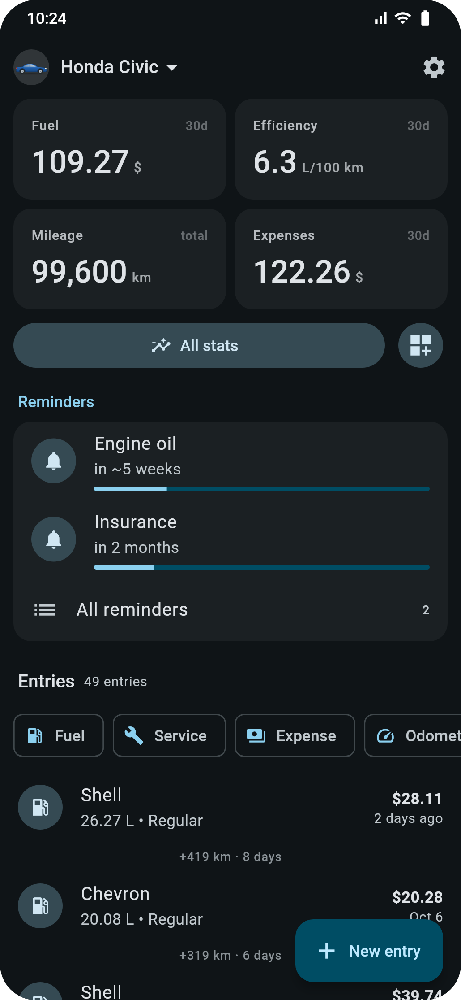
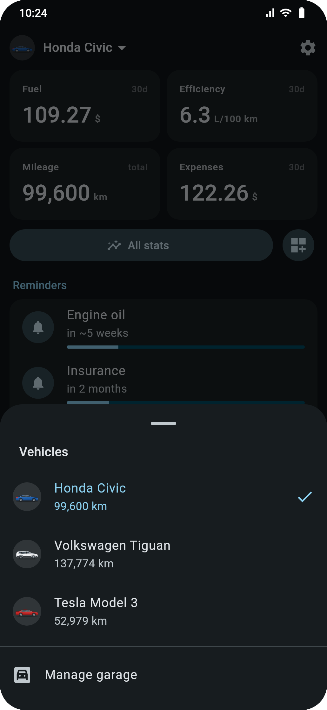
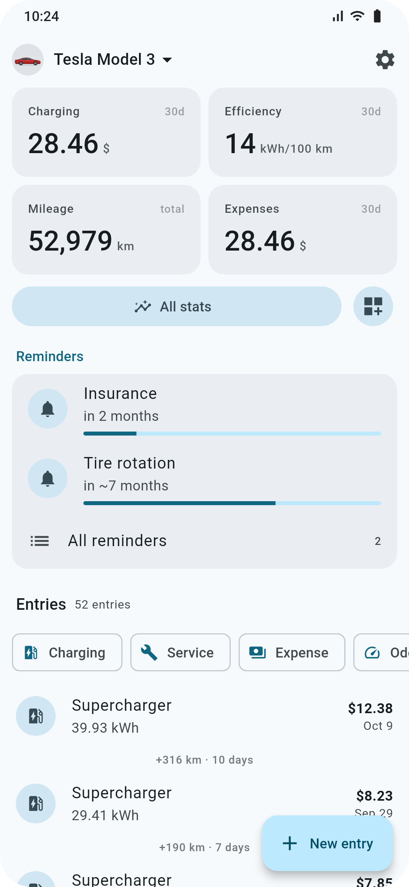
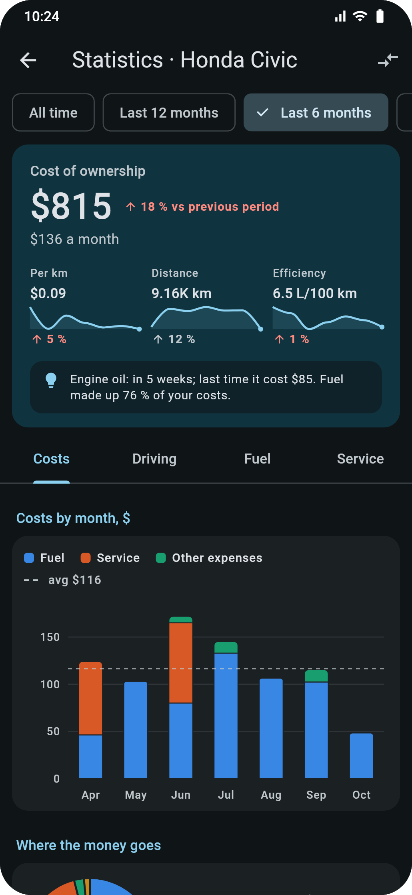
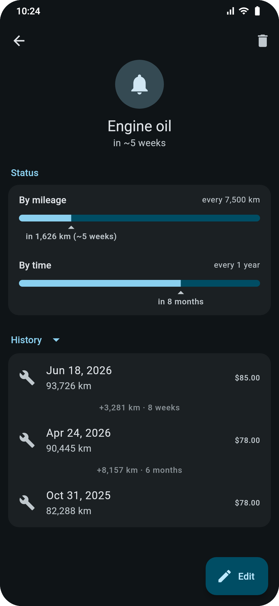
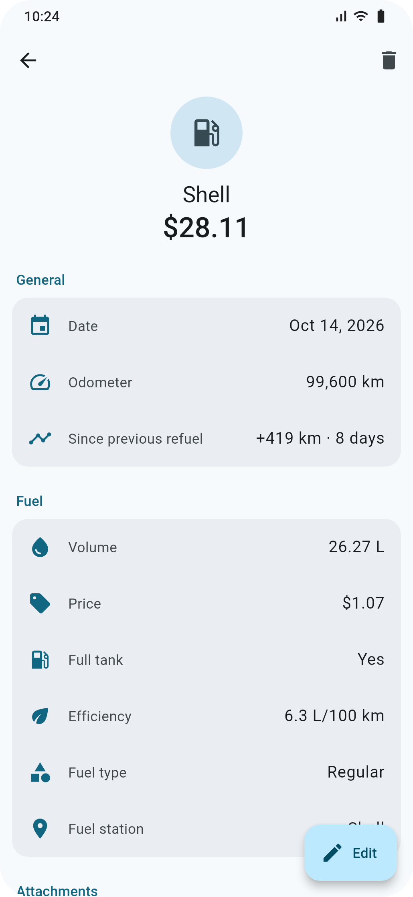
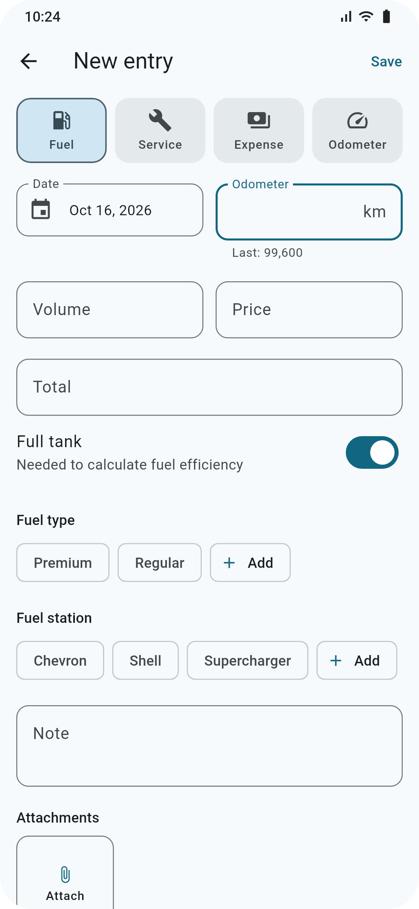
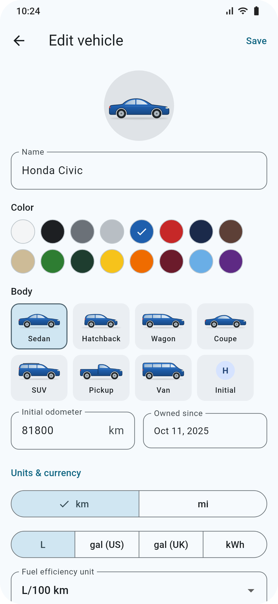
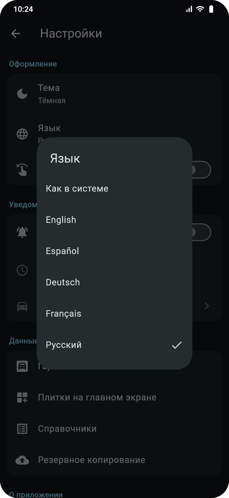
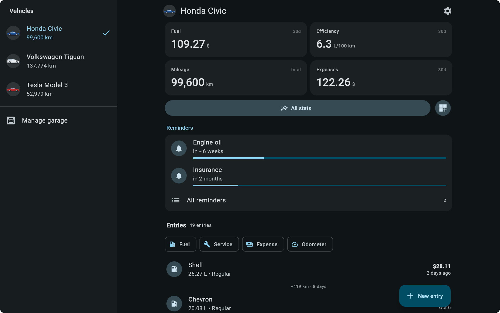

<p align="center"></p>

<h1>garage</h1>

A tracker for your vehicles' fuel, service and expenses, for Android and the web. Your data stays
on your device; backups are a single file you can carry between your phone and the browser.

## Features

- **Several vehicles**, each with its own units and currency: km or miles; litres, US or UK gallons,
  or kWh for electric cars. A small car drawing in the vehicle's body type and colour marks each one.
- **Entries** for refuels (charging for electric cars), service, expenses and odometer readings,
  with the distance and time between them. Attach photos of receipts or PDFs.
- **Home screen** with stat tiles you choose (fuel, efficiency, mileage, costs, price trends…),
  upcoming reminders and the entry history with filters.
- **Statistics** for any period: efficiency, fuel price, costs by month and category, mileage and
  service history, with charts.
- **Maintenance reminders** by distance and/or time, estimated from your average daily mileage,
  with notifications on Android and a history of the intervals between services.
- **Backups** as a `.garage` file: merge it into another device or replace everything; automatic
  restore points inside the app.
- **In-app updates** on Android from GitHub releases; the web version reloads into new deploys.
- **Languages:** English, Spanish, German, French and Russian. Light and dark theme.
- Works on phones, tablets and desktop browsers.

## Screenshots

<table>
  <tr>
    <td></td>
    <td></td>
    <td></td>
  </tr>
  <tr>
    <td></td>
    <td></td>
    <td></td>
  </tr>
  <tr>
    <td></td>
    <td></td>
    <td></td>
  </tr>
</table>



## Get the app

### Web

Open **<https://nuc134r.github.io/garage2/>** in any modern browser. Data is stored in that
browser on that device. To use it like an app, choose *Install app* (Chrome, Edge) or
*Add to Home Screen* (Safari, Chrome on Android).

### Android

1. Open the [latest release](https://github.com/nuc134r/garage2/releases/latest).
2. Download the APK for your phone: `garage-<version>-arm64-v8a.apk` fits almost every phone from the
   last years; `garage-<version>.apk` works everywhere if you are not sure (it is larger).
3. Open the file and allow your browser or file manager to install apps when Android asks.

After that the app offers new releases itself (Settings → App version).

### Moving data between devices

Settings → Backup & restore → *Full backup* saves a `.garage` file; on the other device use
*Restore from file* and choose *Merge* (keeps the newest version of every record) or *Replace all*.

## Building

Flutter app (Android and web), Flutter pinned with [FVM](https://fvm.app) (`.fvmrc`).

- **Drift** (SQLite; WASM in a worker on the web), **Riverpod 3**, **go_router**, **fl_chart**,
  gen-l10n for translations.
- Layout: `lib/core/` (database, units, formatting, shared widgets) and
  `lib/features/<feature>/{data,domain,presentation}`. More in [CLAUDE.md](CLAUDE.md).

```bash
fvm flutter run                 # Android device/emulator
fvm flutter run -d chrome       # web
fvm flutter analyze
fvm flutter test
fvm flutter build apk
fvm flutter build web
```

Debug builds (or `--dart-define=GARAGE_DEMO=true`) show **Settings → Load sample data**.

### Releases

The web version deploys to GitHub Pages on every push to `main`. Android releases are built and
published by the *Release APK* workflow with the notes from [CHANGELOG.md](CHANGELOG.md).
Setup, signing and the release steps: [docs/RELEASING.md](docs/RELEASING.md).

### Code generation

Drift tables generate `lib/core/db/database.g.dart`; ARB files (`lib/l10n/app_*.arb`) generate
`lib/l10n/gen/`.

```bash
fvm dart run build_runner build
fvm flutter gen-l10n
```

### Screenshots

The images above are rendered by a test with fixed sample data, date and fonts, so they only change
when the UI does:

```bash
bash tool/screenshots.sh        # writes docs/screenshots/*.png
```

### Icons

Sources are the SVGs in `icons/`. After changing them, regenerate the Android launcher
(adaptive + themed), notification icon, legacy PNG mipmaps, web icons and `assets/app_icon.png`:

```bash
python tool/generate_icons.py
```

PNGs are rendered with headless Microsoft Edge (override its path with the `EDGE` env var).

### Web database assets

The web build runs SQLite as WASM in a worker. Both files in `web/` must match the resolved
`sqlite3` package version (see `pubspec.lock`). After upgrading drift or sqlite3:

```bash
fvm dart compile js -O4 tool/drift_worker.dart -o web/drift_worker.js
curl -L -o web/sqlite3.wasm https://github.com/simolus3/sqlite3.dart/releases/download/sqlite3-<version>/sqlite3.wasm
```

### Backup format

A backup is a single `.garage` file (plain JSON, identical on Android and web):

- **Quick backup**: all vehicles, entries, reminders and lists.
- **Full backup**: the same plus app settings and entry attachments (base64 in the JSON).
- **Import**: *Merge* upserts by id, keeping the newest version of each row (importing the same
  file twice changes nothing); *Replace all* wipes local data first.
- **Deletions** leave a tombstone that goes into every backup, so a merge deletes the row on the
  other device too — unless it was edited there after the deletion.
- **Restore points**: snapshots kept inside the database (daily and before imports/deletions,
  last 10), so they work on web too. They leave attachments out to stay small; restoring one keeps
  the attachments of entries that still exist.
